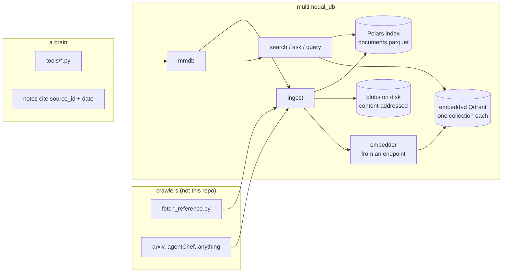

# Architecture

## Modules

| module | owns |
|---|---|
| `config` | `mmdb.toml`: store root, chunking, named endpoints, defaults |
| `providers` | endpoint to LlamaIndex objects, model resolution (`auto`), embedder identity, probes |
| `store` | `Store`, `Collection`, `Document`: the parquet, the blobs, meta.json, the Qdrant client |
| `ingest` | bytes to a row plus vectors: mime and media type, text extraction, chunking, dedup, manifests, reindex |
| `search` | `search` (embedder only), `ask` (retrieve then answer), `query` (LLM writes one Polars expression) |
| `brain` | open a vault read-only: notes, ownership regions, wikilink graph, index it |
| `cli`, `brain_cli` | click commands over the above |
| `testing` | `FakeEmbedding`, `FakeLLM`: the `fake` kind |

## Data model

One row per document in `documents.parquet`:

| column | what |
|---|---|
| `source_id` | the key. Stable id from the crawler: a manifest id, `arxiv:2305.14314`, a relative path |
| `doc_id` | what the vectors are filed under. Survives re-ingests so an update can delete exactly its old chunks |
| `url`, `kind`, `fetched_at` | provenance. `kind` is free text: `web`, `gh-releases`, `arxiv`, `file`, `conversation` |
| `media_type`, `mime` | `text`, `document`, `image`, `audio`, `video`; the mime it was guessed from |
| `content_hash`, `blob_path`, `size` | sha256 of the bytes and where they are |
| `text` | what was extracted, or what the caller passed for media that has no text of its own |
| `title`, `tags`, `metadata` | title from markdown or HTML, a list, a JSON object |
| `embedder`, `n_chunks` | which identity embedded it and how many chunks went to Qdrant |

Chunks are not duplicated into the parquet. They live in Qdrant with their text and a
small payload (`source_id`, `title`, `url`, `kind`) so a hit can be shown without a
second lookup.

Blobs are content-addressed (`blobs/<hh>/<sha256>.<ext>`), so two documents with the
same bytes share one file and re-ingesting the same file writes nothing.

## Ingest

1. Hash the bytes. Same id, same hash, same embedder: `unchanged`, or `touched` when the
   caller passed different provenance (url, kind, title, tags, metadata), which refreshes
   the row and leaves the vectors alone.
2. Guess mime from the filename, extract text (markdown and text as-is, HTML stripped
   of script and style, PDF through pypdf if installed, media gets none unless the caller
   passes `text=`).
3. Write the blob.
4. If the id existed, delete its old vectors by `doc_id`.
5. Split with LlamaIndex's `SentenceSplitter` at the collection's chunk size, embed,
   insert into the Qdrant collection. `n_chunks` is what went in.
6. Upsert the row. The parquet is saved every `save_every` documents and at close.

`ingest_manifest` reads the `manifest.json` a brain's `fetch_reference.py` writes: each
`id` resolves to `<id>.md` under the reference dir or to a directory, whose files ingest
as `<id>/<relative path>`. URL, kind and fetch time come from the manifest entry.

## Brains

A brain is an Obsidian vault in the abstract-brain shape. `Brain.open(path)` reads
`brain.toml` for the contract (markers, tail heading, folder roles, tag prefix) or infers
the same defaults, which the AMD, NVIDIA and MLX vaults all match. Each note is parsed into
its frontmatter (YAML), the generated block between the sync markers if there is one, the
hand-written remainder, its wikilinks (`[[Name]]`, `[[Name|alias]]`, `[[Name#heading]]`,
resolved by filename the way Obsidian does, with code spans and fences ignored) and its
tags (frontmatter plus inline). `nodes()` and `edges()` are Polars frames over that;
`export_graph` writes them as parquet plus a `{nodes, links}` json.

`index()` feeds the notes through the ordinary ingester. The key is the note's path, the
hashed bytes are the body without frontmatter, and layer, role, state, links and the rest
of the frontmatter (minus the sync's own `synced:` clock) ride in metadata. So a daily sync
that only rewrites `synced:` costs nothing, a note that gained a tag is `touched`, a note
that moved from `Open/` to `Archive/` is a new key with the old one pruned, and the vault is
never written to.

## Embedder identity

A collection records `kind:model:dims` the first time anything is embedded into it.
Ingest and search compute the same string from the endpoint they were given and refuse
on mismatch. This is the one rule that costs a little and saves a lot: vectors from two
models look alike and mix without error, and the symptom is recall that is quietly worse.
`reindex` re-embeds every row from its stored text and rewrites the identity, so moving
between endpoints never needs the source files again.

Each identity change is a **generation**: the vectors go to a new Qdrant collection
(`docs__g1`, `docs__g2`, ...) and the previous one is dropped after the new one is
complete. Never a same-name recreate. Embedded Qdrant on Windows keeps a deleted
collection's vector file memory-mapped, and recreating under the old name reads the old
vectors back under the new config, which surfaced as a shape error the first time reindex
ran. A fresh name sidesteps it and leaves the old generation searchable until the new
one is done.

## Models

Nothing in the core imports a model. `providers.embedding_for` and `llm_for` build
LlamaIndex objects from an `Endpoint`, and every class outside the OpenAI-like pair is
imported lazily so an unused kind costs nothing. Adding a kind is one branch in each
function plus a line in `config.KINDS`.

`query` deliberately does not use `llama-index-experimental`'s `PolarsQueryEngine`: that
package pulls in `llama-index-finetuning`, and through it torch, sentence-transformers and
a `mistralai` pin that does not import. The prompt-then-`eval` it does is thirty lines
here, over a namespace holding only `df`, `pl` and a handful of builtins, and the CLI
prints the expression before the result.

## Not here, on purpose

- No REST API and no UI. Consumers are Python and the CLI. If a session needs to query
  it directly, the right surface is a small MCP server, not a web app.
- No agent or conversation model. A transcript is a document of `kind = "conversation"`.
- No graph database. Brains already have wikilinks.
- No crawler. `fetch_reference.py`, an arXiv fetch, agentChef: they produce bytes and
  provenance, this stores them.

## Limits

- The parquet is held in memory and rewritten whole. Fine to the tens of thousands of
  documents; partition it past that.
- Embedded Qdrant locks its directory to one process. Two `mmdb` invocations at once on
  the same root will not both get it.
- Image, audio and video are stored and indexed by whatever text you give them. Embedding
  the media itself (CLIP, audio models) would be another embedder kind on the same rows.
